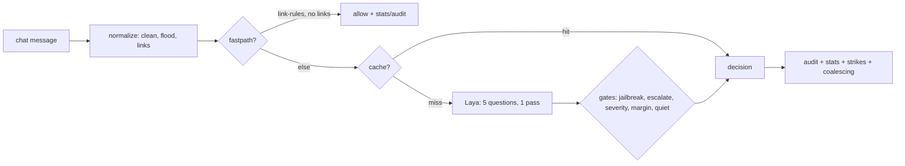

# Architecture (T140, updated T395)



Cache key covers every decision input: message, rules, both thresholds,
severity, lang, bounded context, history window, quiet state, gate knobs —
same text under other settings never gets a stale verdict. Cheap paths
(empty/fastpath) and model-failure fallbacks are recorded in stats + audit too.
Gate precedence: `docs/gates.md`.

## Router pools + circuit breaker (T597)

The `model` node above is not one router — it's a pool, guarded by a breaker:

```mermaid
flowchart LR
    req[moderate(model=, lang=)] --> brk{breaker open?}
    brk -->|yes| esc[escalate, cause=breaker-open]
    brk -->|no| hit{kwargs cached?}
    subgraph pool[RouterPool: LRU by kwargs]
      hit -->|hit| r[Router]
      hit -->|miss + free slot| build[build Router] --> r
      hit -->|miss + full| evict[evict LRU] --> build
    end
    r --> fail{error / timeout?}
    fail -->|no| ok[decision]
    fail -->|yes| streak[consecutive fails += 1]
    streak -->|== breaker_n| trip[open until cooldown]
    trip -->|cooldown over| probe[half-open: one trial]
    probe -->|success| close[close breaker]
    probe -->|failure| trip
```

* **Pool** (`pool.py`): LRU keyed by constructor kwargs (`model`, `device`, …),
  `BOUNCER_POOL_MAX` slots (default 2), per-pool hit/create/evict counters in
  `/stats`, `/ready`, `bouncer models`. Size it ≥ hot checkpoints or every
  request pays a reload (`eval/bench_pool.py` shows the thrash case).
* **Breaker** (`__init__.py`): `breaker_n` consecutive failures open it;
  after `breaker_cool_s` one half-open trial decides close vs. re-trip. While
  open, requests short-circuit to `escalate` (`cause=breaker-open`) — never
  allow. `BOUNCER_BREAKER=off` disables; per-request `timeout_s` feeds the
  failure streak. Simulation: `eval/breaker_sim.py`.

Terms used here are defined in the [Glossary](glossary.md).
