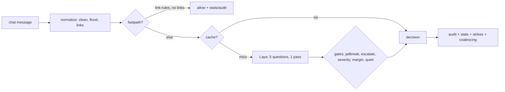

# Architecture (T140, updated T395)

Cache key covers every decision input: message, rules, both thresholds,
severity, lang, bounded context, history window, quiet state, gate knobs —
same text under other settings never gets a stale verdict. Cheap paths
(empty/fastpath) and model-failure fallbacks are recorded in stats + audit too.
Gate precedence: `docs/gates.md`.
